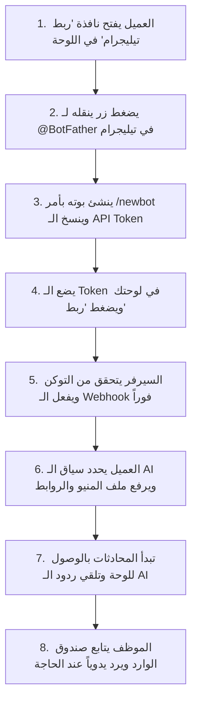

# دليل تكامل Telegram للواجهة الأمامية (Frontend Developer Guide)

هذا الدليل مخصص لمطوري الواجهة الأمامية (**Frontend Developers**) للربط مع جميع واجهات برمجة التطبيقات (**APIs**) الخاصة بتكامل تيليجرام (**Telegram Integration**) من جهة المستخدم (`/api/user/...`).

يغطي هذا الدليل:
1. **طريقة وسيناريو العمل (Workflow & UX).**
2. **إدارة البوتات والذكاء الاصطناعي (Bot Connection & AI Data Management).**
3. **صندوق المحادثات والرسائل والرد اليدوي (Live Chat / Inbox & Manual Reply).**
4. **جميع الـ Headers والـ Parameters والـ Body ونماذج كاملة للـ Responses الناجحة والأخطاء.**

---

## الفهرس
1. [المصادقة والـ Headers الأساسية](#1-المصادقة-والـ-headers-الأساسية)
2. [سيناريو ودورة عمل المستخدم (UX & Workflow)](#2-سيناريو-ودورة-عمل-المستخدم-ux--workflow)
3. [واجهات إدارة البوت والذكاء الاصطناعي (Telegram Accounts APIs)](#3-واجهات-إدارة-البوت-والذكاء-الاصطناعي-telegram-accounts-apis)
   - [1. ربط بوت جديد (Connect Bot)](#1-ربط-بوت-جديد-connect-bot)
   - [2. جلب جميع البوتات المرتبطة (List Accounts)](#2-جلب-جميع-البوتات-المرتبطة-list-accounts)
   - [3. تفاصيل بوت محدد (Show Account)](#3-تفاصيل-بوت-محدد-show-account)
   - [4. تحديث بيانات الـ AI والروابط (Update Account)](#4-تحديث-بيانات-الـ-ai-والروابط-update-account)
   - [5. فصل وحذف البوت (Disconnect Bot)](#5-فصل-وحذف-البوت-disconnect-bot)
   - [6. فحص حالة الـ Webhook مباشرة من تيليجرام (Get Webhook Info)](#6-فحص-حالة-الـ-webhook-مباشرة-من-تيليجرام-get-webhook-info)
   - [7. إعادة ربط وتسجيل الـ Webhook (Resubscribe Webhook)](#7-إعادة-ربط-وتسجيل-الـ-webhook-resubscribe-webhook)
4. [واجهات المحادثات والـ Inbox (Live Chat APIs)](#4-واجهات-المحادثات-والـ-inbox-live-chat-apis)
   - [1. جلب الحسابات مع عداد غير المقروء (Chat Accounts)](#1-جلب-الحسابات-مع-عداد-غير-المقروء-chat-accounts)
   - [2. جلب قائمة محادثات العملاء (Conversations List)](#2-جلب-قائمة-محادثات-العملاء-conversations-list)
   - [3. جلب رسائل محادثة عميل محدد (Messages History)](#3-جلب-رسائل-محادثة-عميل-محدد-messages-history)
   - [4. إرسال رد يدوي من الموظف للعميل (Send Manual Reply)](#4-إرسال-رد-يدوي-من-الموظف-للعميل-send-manual-reply)
5. [قاموس الحقول الموحدة (Standardized Keys Dictionary)](#5-قاموس-الحقول-الموحدة-standardized-keys-dictionary)
6. [أمثلة كود جاهزة للواجهة الأمامية (React / Axios Examples)](#6-أمثلة-كود-جاهزة-للواجهة-الأمامية-react--axios-examples)

---

## 1. المصادقة والـ Headers الأساسية

جميع المسارات الموجودة في هذا الدليل تتطلب تسجيل دخول المستخدم (User Sanctum Token). يجب إرسال الـ Headers التالية في كل طلب:

```http
Authorization: Bearer <USER_SANCTUM_TOKEN>
Accept: application/json
```

> [!NOTE]
> عند إرسال ملفات (مثل `ai_file`)، يجب أن يكون الـ `Content-Type: multipart/form-data`. أما في باقي الطلبات فيكون `Content-Type: application/json`.

---

## 2. سيناريو ودورة عمل المستخدم (UX & Workflow)



### شكل الشاشات المقترحة في الفرونت إند:
1. **شاشة الربط (Connect Modal):**
   * خطوة 1: رابط مباشر يفتح تطبيق تيليجرام: `https://t.me/BotFather`.
   * خطوة 2: تعليمات للمستخدم لكتابة `/newbot` واختيار اسم البوت ومعرفه.
   * خطوة 3: حقل إدخال نصي (`bot_token`) + حقول اختيارية أولية (`ai_context`, `website_url`, إلخ).
   * زر: **"ربط وتفعيل البوت"**.

2. **شاشة إعدادات البوت والذكاء الاصطناعي (Settings Tab):**
   * تعديل `ai_context` (Textarea).
   * رفع `ai_file` (ملف `.txt` أو `.md`).
   * روابط الطلب: `website_url`, `android_link`, `ios_link`.
   * مفتاح تفعيل/تعطيل الرد الآلي (`status: active / disabled`).

3. **شاشة صندوق الوارد والمحادثات (Chat / Inbox Tab):**
   * عمود أيمن: قائمة بالعملاء المتحدثين مع البوت (`conversations`) والرسائل غير المقروءة.
   * عمود أوسط: سجل الرسائل الحية (`messages`).
   * شريط سفلي: حقل كتابة رسالة وزر **إرسال** للرد اليدوي المباشر من اللوحة.

---

## 3. واجهات إدارة البوت والذكاء الاصطناعي (Telegram Accounts APIs)

### 1. ربط بوت جديد (Connect Bot)

يقوم بالتحقق من الـ Token عبر تيليجرام وربطه بالمستخدم الحالي وتسجيل الـ Webhook تلقائياً.

* **المسار:** `POST /api/user/telegram/connect`
* **Content-Type:** `multipart/form-data` أو `application/json`

#### المدخلات (Body Parameters):
| الحقل | النوع | الإلزام | الوصف |
| :--- | :---: | :---: | :--- |
| `bot_token` | `string` | **مطلوب** | التوكن المستخرج من BotFather (مثل: `123456789:AAFxxx...`). |
| `ai_context` | `string` | اختياري | السياق التوجيهي للذكاء الاصطناعي (مثلاً: *"أنت موظف خدمة عملاء في مطعم كيتو..."*). |
| `ai_file` | `file` | اختياري | ملف نصي يحتوي على المنيو والأسعار والمعلومات (`.txt`, `.md` بحد أقصى 2MB). |
| `website_url` | `string` | اختياري | رابط موقع المتجر للطلب (حتى 500 حرف). |
| `android_link` | `string` | اختياري | رابط تطبيق أندرويد على Google Play. |
| `ios_link` | `string` | اختياري | رابط تطبيق iOS على App Store. |

#### الاستجابة الناجحة (201 Created):
```json
{
  "status": true,
  "message": "Telegram bot connected successfully.",
  "data": {
    "id": 1,
    "bot_id": "7123456789",
    "bot_username": "keeto_restaurant_bot",
    "bot_name": "Keeto Restaurant",
    "status": "active",
    "msg_number": 0,
    "start_date": null,
    "end_date": null,
    "ai_context": "أنت موظف خدمة عملاء في مطعم كيتو",
    "ai_file": "telegram/ai_files/xyz123.md",
    "android_link": "https://play.google.com/store/apps/details?id=com.keeto",
    "ios_link": "https://apps.apple.com/app/keeto/id123456",
    "website_url": "https://keeto.org",
    "subscription_status": false,
    "available_msgs": 0,
    "webhook_registered": true
  }
}
```

#### حالات الخطأ المحتملة:
* **400 Bad Request:** التوكن غير صالح أو تعذر الوصول لـ Telegram API:
  ```json
  { "status": false, "message": "Unauthorized" }
  ```
* **422 Unprocessable Entity:** البوت مرتبط بالفعل بحساب مستخدم آخر أو خطأ في صيغة المدخلات:
  ```json
  { "status": false, "message": "This Telegram bot is already linked to another account." }
  ```

---

### 2. جلب جميع البوتات المرتبطة (List Accounts)

يعرض قائمة بجميع بوتات تيليجرام المربوطة بالمستخدم الحالي مع حالة الاشتراك وعدد الرسائل المتبقية.

* **المسار:** `GET /api/user/telegram/accounts`

#### الاستجابة الناجحة (200 OK):
```json
{
  "status": true,
  "data": [
    {
      "id": 1,
      "bot_id": "7123456789",
      "bot_username": "keeto_restaurant_bot",
      "bot_name": "Keeto Restaurant",
      "status": "active",
      "msg_number": 500,
      "start_date": "2026-10-01",
      "end_date": "2026-11-01",
      "ai_context": "أنت موظف خدمة عملاء في مطعم كيتو",
      "ai_file": "telegram/ai_files/xyz123.md",
      "android_link": "https://play.google.com/store/apps/details?id=com.keeto",
      "ios_link": "https://apps.apple.com/app/keeto/id123456",
      "website_url": "https://keeto.org",
      "subscription_status": true,
      "available_msgs": 482,
      "created_at": "2026-10-26 14:00:00"
    }
  ]
}
```

---

### 3. تفاصيل بوت محدد (Show Account)

* **المسار:** `GET /api/user/telegram/accounts/{id}`

#### الاستجابة الناجحة (200 OK):
```json
{
  "status": true,
  "data": {
    "id": 1,
    "bot_id": "7123456789",
    "bot_username": "keeto_restaurant_bot",
    "bot_name": "Keeto Restaurant",
    "status": "active",
    "msg_number": 500,
    "start_date": "2026-10-01",
    "end_date": "2026-11-01",
    "ai_context": "أنت موظف خدمة عملاء في مطعم كيتو",
    "ai_file": "telegram/ai_files/xyz123.md",
    "android_link": "https://play.google.com/store/apps/details?id=com.keeto",
    "ios_link": "https://apps.apple.com/app/keeto/id123456",
    "website_url": "https://keeto.org",
    "subscription_status": true,
    "available_msgs": 482,
    "created_at": "2026-10-26 14:00:00"
  }
}
```

---

### 4. تحديث بيانات الـ AI والروابط (Update Account)

لتعديل سياق الـ AI أو رفع ملف منيو جديد أو تحديث روابط التطبيقات والموقع أو إيقاف/تفعيل الرد الآلي.

* **المسار:** `POST /api/user/telegram/accounts/{id}` أو `PUT /api/user/telegram/accounts/{id}`
* **Content-Type:** `multipart/form-data` (عند رفع ملف) أو `application/json`

#### المدخلات (Body Parameters):
| الحقل | النوع | الإلزام | الوصف |
| :--- | :---: | :---: | :--- |
| `ai_context` | `string` | اختياري | تحديث السياق الإرشادي للـ AI. |
| `ai_file` | `file` أو `string` | اختياري | ملف جديد `.txt` أو `.md` بحد أقصى 2MB، أو مسار الملف القديم للإبقاء عليه. |
| `website_url` | `string` | اختياري | تحديث رابط الموقع. |
| `android_link` | `string` | اختياري | تحديث رابط تطبيق أندرويد. |
| `ios_link` | `string` | اختياري | تحديث رابط تطبيق iOS. |
| `status` | `string` | اختياري | الحالة: إما `active` (تشغيل الرد الآلي) أو `disabled` (إيقافه مؤقتاً). |

#### الاستجابة الناجحة (200 OK):
```json
{
  "status": true,
  "message": "Telegram account updated successfully.",
  "data": {
    "id": 1,
    "bot_id": "7123456789",
    "bot_username": "keeto_restaurant_bot",
    "bot_name": "Keeto Restaurant",
    "status": "active",
    "msg_number": 500,
    "start_date": "2026-10-01",
    "end_date": "2026-11-01",
    "ai_context": "أنت موظف خدمة عملاء في مطعم كيتو، رد دائماً بترحيب ولباقة",
    "ai_file": "telegram/ai_files/new_menu.md",
    "android_link": "https://play.google.com/store/apps/details?id=com.keeto.updated",
    "ios_link": "https://apps.apple.com/app/keeto/id123456",
    "website_url": "https://order.keeto.org",
    "subscription_status": true,
    "available_msgs": 482
  }
}
```

---

### 5. فصل وحذف البوت (Disconnect Bot)

يقوم بحذف الـ Webhook رسمياً من سيرفرات تيليجرام وحذف سجل البوت من حساب المستخدم.

* **المسار:** `DELETE /api/user/telegram/accounts/{id}`

#### الاستجابة الناجحة (200 OK):
```json
{
  "status": true,
  "message": "Telegram bot disconnected successfully."
}
```

---

### 6. فحص حالة الـ Webhook مباشرة من تيليجرام (Get Webhook Info)

يُستخدم للتشخيص وتأكيد أن تيليجرام يعرف رابط الـ Webhook بنجاح، ومعرفة ما إذا كان هناك رسائل معلقة أو أي خطأ في الاتصال.

* **المسار:** `GET /api/user/telegram/accounts/{id}/webhook-info`

#### الاستجابة الناجحة (200 OK):
```json
{
  "status": true,
  "data": {
    "account_id": 1,
    "bot_username": "smartego_bot",
    "webhook_info": {
      "url": "https://bcknd.smartego.org/api/telegram-webhook/1",
      "has_custom_certificate": false,
      "pending_update_count": 0,
      "last_error_date": null,
      "last_error_message": null,
      "max_connections": 40,
      "ip_address": "..."
    }
  }
}
```

---

### 7. إعادة ربط وتسجيل الـ Webhook (Resubscribe Webhook)

في حال حدوث أي خطأ بالاتصال في تيليجرام أو تغيير دومين السيرفر، يمكن استدعاء هذا المسار لإعادة تسجيل رابط الـ Webhook رسمياً وفرض HTTPS.

* **المسار:** `POST /api/user/telegram/accounts/{id}/resubscribe-webhook`

#### الاستجابة الناجحة (200 OK):
```json
{
  "status": true,
  "message": "Webhook resubscribed successfully.",
  "data": {
    "webhook_url": "https://bcknd.smartego.org/api/telegram-webhook/1",
    "telegram_response": {
      "ok": true,
      "result": true,
      "description": "Webhook was set"
    }
  }
}
```

---

## 4. واجهات المحادثات والـ Inbox (Live Chat APIs)

هذه الواجهات متطابقة بنيوياً ومفاهيمياً مع واجهات ماسنجر في لوحة التحكم (`chat/messenger/...`).

### 1. جلب الحسابات مع عداد غير المقروء (Chat Accounts)

يُستخدم في شاشة الشات الرئيسية لعرض البوتات المتاحة للمستخدم وعدد الرسائل الجديدة غير المقروءة لكل بوت.

* **المسار:** `GET /api/user/chat/telegram/accounts`
* **Query Parameters:**
  * `page` (اختياري - default: 1)
  * `per_page` (اختياري - default: 15)
  * `search` (اختياري - بحث بالاسم أو المعرف)
  * `paginate` (اختياري: `true` أو `false` - default: `true`)

#### الاستجابة الناجحة (200 OK):
```json
{
  "status": true,
  "data": [
    {
      "id": 1,
      "bot_id": "7123456789",
      "bot_username": "keeto_restaurant_bot",
      "bot_name": "Keeto Restaurant",
      "status": "active",
      "msg_number": 500,
      "unread_count": 3,
      "total_conversations": 42,
      "subscription_status": true,
      "available_msgs": 482,
      "created_at": "2026-10-26 14:00:00"
    }
  ],
  "pagination": {
    "current_page": 1,
    "last_page": 1,
    "per_page": 15,
    "total": 1,
    "from": 1,
    "to": 1,
    "has_more": false
  }
}
```

---

### 2. جلب قائمة محادثات العملاء (Conversations List)

يعرض قائمة العملاء الذين راسلوا البوت في تيليجرام (مرتبين من الأحدث للأقدم)، لعرضهم في الشريط الجانبي لصندوق الوارد.

* **المسار:** `GET /api/user/chat/telegram/conversations`
* **Query Parameters:**
  * `telegram_account_id` (مطلوب - معرّف البوت الداخلي في الداتابيز).
  * `search` (اختياري - بحث باسم العميل أو معرفه `sender_id` أو نص الرسالة).
  * `page` (اختياري - default: 1)
  * `per_page` (اختياري - default: 15)
  * `paginate` (اختياري - default: `true`)

#### الاستجابة الناجحة (200 OK):
```json
{
  "status": true,
  "telegram_account_id": 1,
  "bot_id": "7123456789",
  "bot_username": "keeto_restaurant_bot",
  "bot_name": "Keeto Restaurant",
  "data": [
    {
      "sender_id": "184920482",
      "name": "Ahmed Mahmoud",
      "last_message": "هل متاح توصيل لمنطقة المعادي؟",
      "last_message_at": "2026-10-26 15:20:11",
      "last_sender_type": "customer",
      "unread_count": 1
    },
    {
      "sender_id": "992817263",
      "name": "Sara Ali",
      "last_message": "شكراً جزيلاً تم الطلب بنجاح",
      "last_message_at": "2026-10-26 14:45:00",
      "last_sender_type": "bot",
      "unread_count": 0
    }
  ],
  "pagination": {
    "current_page": 1,
    "last_page": 1,
    "per_page": 15,
    "total": 2,
    "from": 1,
    "to": 2,
    "has_more": false
  }
}
```

> [!NOTE]
> `sender_id` هو المعرف الرقمي الفريد للعميل على تيليجرام (Chat ID). يتم استخدامه لجلب رسائل العميل وإرسال رد إليه.

---

### 3. جلب رسائل محادثة عميل محدد (Messages History)

يعرض سجل الرسائل المتبادلة بين البوت والعميل بالكامل، **ويقوم تلقائياً بتحديد الرسائل غير المقروءة كمقروءة (Mark as Read)**.

* **المسار:** `GET /api/user/chat/telegram/messages`
* **Query Parameters:**
  * `telegram_account_id` (مطلوب - معرّف البوت).
  * `sender_id` (مطلوب - معرّف العميل المستخرج من قائمة الـ conversations).
  * `search` (اختياري - بحث بنص رسالة معينة).
  * `page` (اختياري - default: 1)
  * `per_page` (اختياري - default: 30)
  * `paginate` (اختياري - default: `true`)

#### الاستجابة الناجحة (200 OK):
```json
{
  "status": true,
  "telegram_account_id": 1,
  "bot_id": "7123456789",
  "bot_username": "keeto_restaurant_bot",
  "sender_id": "184920482",
  "data": [
    {
      "id": 105,
      "message": "أهلاً بك يا فندم! نعم متاح التوصيل للمعادي ومدة التوصيل 45 دقيقة.",
      "is_image": false,
      "is_admin": true,
      "sender_type": "bot",
      "is_read": true,
      "read_at": "2026-10-26 15:20:15",
      "created_at": "2026-10-26 15:20:15"
    },
    {
      "id": 104,
      "message": "هل متاح توصيل لمنطقة المعادي؟",
      "is_image": false,
      "is_admin": false,
      "sender_type": "customer",
      "is_read": true,
      "read_at": "2026-10-26 15:22:00",
      "created_at": "2026-10-26 15:20:11"
    }
  ],
  "pagination": {
    "current_page": 1,
    "last_page": 1,
    "per_page": 30,
    "total": 2,
    "from": 1,
    "to": 2,
    "has_more": false
  }
}
```

#### تمييز أطراف المحادثة:
* `sender_type === 'customer'`: رسالة أرسلها العميل من تطبيق تيليجرام.
* `sender_type === 'bot'`: رد آلي تولد عن طريق الذكاء الاصطناعي (OpenAI).
* `sender_type === 'agent'`: رد يدوي كتبه موظف خدمة العملاء من لوحة التحكم.

---

### 4. إرسال رد يدوي من الموظف للعميل (Send Manual Reply)

يسمح لموظف الدعم بالتدخل في أي وقت وكتابة رسالة من لوحة التحكم لتصل فوراً لهاتف العميل على تيليجرام وتظهر في شات البوت.

* **المسار:** `POST /api/user/chat/telegram/send`
* **Content-Type:** `application/json`

#### المدخلات (Body Parameters):
| الحقل | النوع | الإلزام | الوصف |
| :--- | :---: | :---: | :--- |
| `telegram_account_id` | `integer` | **مطلوب** | معرّف البوت. |
| `recipient_id` (أو `sender_id`) | `string` | **مطلوب** | معرّف العميل على تيليجرام (نفس قيمة `sender_id`). |
| `message` | `string` | **مطلوب** | نص الرد المراد إرساله للعميل (بحد أقصى 4000 حرف). |

#### مثال للـ Request Body:
```json
{
  "telegram_account_id": 1,
  "recipient_id": "184920482",
  "message": "أهلاً بحضرتك يا فندم، أنا الموظف المسؤول معك، تفضل بتأكيد عنوانك بالتفصيل لنقوم بتجهيز الأوردر."
}
```

#### الاستجابة الناجحة (200 OK):
```json
{
  "status": true,
  "message": "Message sent successfully.",
  "data": {
    "id": 106,
    "telegram_account_id": 1,
    "sender_id": "184920482",
    "message": "أهلاً بحضرتك يا فندم، أنا الموظف المسؤول معك، تفضل بتأكيد عنوانك بالتفصيل لنقوم بتجهيز الأوردر.",
    "sender_type": "agent",
    "created_at": "2026-10-26 15:25:30"
  }
}
```

---

## 5. قاموس الحقول الموحدة (Standardized Keys Dictionary)

لضمان عدم حدوث تضارب في مسميات الحقول في الفرونت إند:

| مفتاح الحقل (Key) | النوع | المعنى والاستخدام |
| :--- | :--- | :--- |
| `bot_token` | `string` | التوكن السري للبوت الصادر من BotFather. |
| `bot_id` | `string` | المعرّف الرقمي للبوت من تيليجرام. |
| `bot_username` | `string` | يوزر نيم البوت (مثل `my_store_bot`). |
| `bot_name` | `string` | الاسم الظاهر للبوت (مثل `متجر الأناقة`). |
| `sender_id` | `string` | المعرّف الرقمي للعميل في تيليجرام (Chat ID). |
| `telegram_account_id`| `integer` | الـ ID الداخلي لحساب البوت في قاعدة البيانات. |
| `ai_context` | `string` | التعليمات التوجيهية لموظف الذكاء الاصطناعي. |
| `ai_file` | `file / string` | ملف المنيو أو الأسعار أو الخدمات. |
| `android_link` | `string` | رابط تحميل تطبيق الأندرويد. |
| `ios_link` | `string` | رابط تحميل تطبيق الآيفون. |
| `website_url` | `string` | رابط موقع الويب لطلب المنتجات. |
| `msg_number` | `integer` | عدد الرسائل الإجمالي في الباقة. |
| `available_msgs` | `integer` | رصيد الرسائل المتبقي حالياً. |
| `subscription_status`| `boolean` | هل اشتراك البوت مفعل وساري (`true`/`false`). |
| `start_date` / `end_date` | `date` (YYYY-MM-DD) | تاريخ بدء وانتهاء صلاحية الاشتراك. |

---

## 6. أمثلة كود جاهزة للواجهة الأمامية (React / Axios Examples)

### أ) دالة ربط البوت الجديد:
```javascript
import axios from 'axios';

const api = axios.create({
  baseURL: 'https://bcknd.smartego.org/api',
  headers: {
    Authorization: `Bearer ${localStorage.getItem('token')}`,
    Accept: 'application/json',
  },
});

export const connectTelegramBot = async (formData) => {
  // formData can contain: bot_token, ai_context, website_url, ai_file (File object)
  const response = await api.post('/user/telegram/connect', formData, {
    headers: { 'Content-Type': 'multipart/form-data' },
  });
  return response.data;
};
```

### ب) دالة جلب المحادثات والرسائل:
```javascript
// جلب قائمة العملاء
export const getTelegramConversations = async (telegramAccountId, search = '', page = 1) => {
  const response = await api.get('/user/chat/telegram/conversations', {
    params: {
      telegram_account_id: telegramAccountId,
      search,
      page,
    },
  });
  return response.data;
};

// جلب رسائل الشات مع عميل معين
export const getTelegramMessages = async (telegramAccountId, senderId, page = 1) => {
  const response = await api.get('/user/chat/telegram/messages', {
    params: {
      telegram_account_id: telegramAccountId,
      sender_id: senderId,
      page,
    },
  });
  return response.data;
};
```

### ج) دالة إرسال رد يدوي من الموظف للعميل:
```javascript
export const sendTelegramReply = async (telegramAccountId, recipientId, message) => {
  const response = await api.post('/user/chat/telegram/send', {
    telegram_account_id: telegramAccountId,
    recipient_id: recipientId,
    message: message,
  });
  return response.data;
};
```
