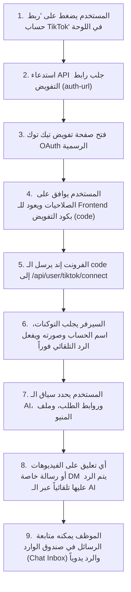

# دليل تكامل TikTok للواجهة الأمامية للمستخدم (Frontend User Guide)

هذا الدليل مخصص لمطوري الواجهة الأمامية (**Frontend Developers**) للربط مع جميع واجهات برمجة التطبيقات (**APIs**) الخاصة بتكامل تيك توك (**TikTok Integration**) من جهة المستخدم (`/api/user/...`).

يغطي هذا الدليل:
1. **طريقة وسيناريو العمل والربط (Workflow & UX).**
2. **إدارة حسابات تيك توك والذكاء الاصطناعي (Account Connection & AI Management).**
3. **صندوق المحادثات والرسائل والرد اليدوي (Live Chat / Inbox & Manual Reply).**
4. **جميع الـ Headers والـ Parameters والـ Body ونماذج كاملة للـ Responses الناجحة والأخطاء.**
5. **أمثلة كود جاهزة (React / Axios).**

---

## الفهرس
1. [المصادقة والـ Headers الأساسية](#1-المصادقة-والـ-headers-الأساسية)
2. [سيناريو ودورة عمل المستخدم (UX & Workflow)](#2-سيناريو-ودورة-عمل-المستخدم-ux--workflow)
3. [واجهات إدارة حسابات تيك توك والذكاء الاصطناعي (TikTok Accounts APIs)](#3-واجهات-إدارة-حسابات-تيك-توك-والذكاء-الاصطناعي-tiktok-accounts-apis)
   - [1. توليد رابط تفويض تيك توك (Get Auth URL)](#1-توليد-رابط-تفويض-تيك-توك-get-auth-url)
   - [2. ربط حساب جديد (Connect Account)](#2-ربط-حساب-جديد-connect-account)
   - [3. جلب جميع الحسابات المرتبطة (List Accounts)](#3-جلب-جميع-الحسابات-المرتبطة-list-accounts)
   - [4. تفاصيل حساب محدد (Show Account)](#4-تفاصيل-حساب-محدد-show-account)
   - [5. تحديث بيانات الـ AI والروابط (Update Account)](#5-تحديث-بيانات-الـ-ai-والروابط-update-account)
   - [6. تجديد توكن الوصول يدوياً (Refresh Token)](#6-تجديد-توكن-الوصول-يدوياً-refresh-token)
   - [7. فصل وحذف الحساب (Disconnect Account)](#7-فصل-وحذف-الحساب-disconnect-account)
4. [واجهات المحادثات والـ Inbox (Live Chat APIs)](#4-واجهات-المحادثات-والـ-inbox-live-chat-apis)
   - [1. جلب الحسابات مع عداد غير المقروء (Chat Accounts)](#1-جلب-الحسابات-مع-عداد-غير-المقروء-chat-accounts)
   - [2. جلب قائمة محادثات العملاء (Conversations List)](#2-جلب-قائمة-محادثات-العملاء-conversations-list)
   - [3. جلب رسائل محادثة عميل محدد (Messages History)](#3-جلب-رسائل-محادثة-عميل-محدد-messages-history)
   - [4. إرسال رد يدوي من الموظف للعميل (Send Manual Reply)](#4-إرسال-رد-يدوي-من-الموظف-للعميل-send-manual-reply)
5. [قاموس الحقول الموحدة (Standardized Keys Dictionary)](#5-قاموس-الحقول-الموحدة-standardized-keys-dictionary)
6. [أمثلة كود جاهزة للواجهة الأمامية (React / Axios)](#6-أمثلة-كود-جاهزة-للواجهة-الأمامية-react--axios)

---

## 1. المصادقة والـ Headers الأساسية

جميع المسارات الموجودة في هذا الدليل تتطلب تسجيل دخول المستخدم (User Sanctum Token). يجب إرسال الـ Headers التالية في كل طلب:

```http
Authorization: Bearer <USER_SANCTUM_TOKEN>
Accept: application/json
```

> [!NOTE]
> عند إرسال ملفات (مثل `ai_file`)، يجب أن يكون الـ `Content-Type: multipart/form-data`. أما في باقي الطلبات فيكون `Content-Type: application/json`.

---

## 2. سيناريو ودورة عمل المستخدم (UX & Workflow)



---

## 3. واجهات إدارة حسابات تيك توك والذكاء الاصطناعي (TikTok Accounts APIs)

### 1. توليد رابط تفويض تيك توك (Get Auth URL)

يولد رابط الـ OAuth الرسمي لتوجيه المستخدم إليه لتسجيل الدخول بحساب الـ Business والموافقة على الصلاحيات.

* **المسار:** `GET /api/user/tiktok/auth-url`
* **Query Parameters (اختياري):**
  * `redirect_uri` (اختياري): رابط إعادة التوجيه للفرونت إند إذا أردت تجاوزه.

#### الاستجابة الناجحة (200 OK):
```json
{
  "status": true,
  "data": {
    "authorization_url": "https://www.tiktok.com/v2/auth/authorize/?client_key=aw123456...&scope=user.info.basic%2Cvideo.list%2Ccomment.list%2Ccomment.list.manage%2Cbusiness.messages&response_type=code&redirect_uri=https%3A%2F%2Fapp.smartego.org%2Fauth%2Ftiktok%2Fcallback&state=random_state_string_12",
    "state": "random_state_string_12"
  }
}
```

---

### 2. ربط حساب جديد (Connect Account)

يقبل كود التفويض (`code`) الناتج من تيك توك OAuth، أو يقبل التوكن والـ `open_id` مباشرة. يقوم بتخزين الحساب وتفعيل باقة تجريبية أولية (50 رسالة / 30 يوم) للمشتركين الجدد.

* **المسار:** `POST /api/user/tiktok/connect`
* **Content-Type:** `multipart/form-data` أو `application/json`

#### المدخلات (Body Parameters):
| الحقل | النوع | الإلزام | الوصف |
| :--- | :---: | :---: | :--- |
| `code` | `string` | **مطلوب** (أو إرسال access_token + open_id) | كود التفويض الراجع من تيك توك بعد موافقة العميل. |
| `redirect_uri` | `url` | اختياري | الـ Redirect URI المستخدم أثناء التفويض (إن وُجد). |
| `access_token` | `string` | اختياري (بديل code) | توكن وصول الحساب المباشر. |
| `refresh_token` | `string` | اختياري | توكن التجديد. |
| `open_id` | `string` | اختياري (مطلوب مع access_token) | معرف الحساب على تيك توك (`open_id`). |
| `ai_context` | `string` | اختياري | سياق الذكاء الاصطناعي التوجيهي للردود. |
| `ai_file` | `file` | اختياري | ملف منيو أو بيانات بصيغة `.txt` أو `.md` (بحد أقصى 2MB). |
| `website_url` | `string` | اختياري | رابط موقع المتجر للطلب أونلاين. |
| `android_link` | `string` | اختياري | رابط تطبيق أندرويد. |
| `ios_link` | `string` | اختياري | رابط تطبيق iOS. |

#### الاستجابة الناجحة (201 Created):
```json
{
  "status": true,
  "message": "TikTok account connected successfully.",
  "data": {
    "id": 1,
    "open_id": "act_8839201948",
    "username": "smartego_store",
    "display_name": "SmartEgo Official",
    "avatar_url": "https://p16-sign-va.tiktokcdn.com/avatar.jpeg",
    "status": "active",
    "msg_number": 50,
    "start_date": "2026-10-27",
    "end_date": "2026-11-26",
    "ai_context": "أنت موظف خدمة عملاء في متجر سمارت إيجو، رد باختصار وأدب.",
    "ai_file": "tiktok/ai_files/menu.txt",
    "android_link": "https://play.google.com/store/apps/details?id=com.smartego",
    "ios_link": "https://apps.apple.com/app/smartego/id123",
    "website_url": "https://smartego.org",
    "subscription_status": true,
    "available_msgs": 50
  }
}
```

---

### 3. جلب جميع الحسابات المرتبطة (List Accounts)

يعرض الحسابات المرتبطة بالمستخدم مع حالة كل حساب وعدد الرسائل المتبقية.

* **المسار:** `GET /api/user/tiktok/accounts`

#### الاستجابة الناجحة (200 OK):
```json
{
  "status": true,
  "data": [
    {
      "id": 1,
      "open_id": "act_8839201948",
      "username": "smartego_store",
      "display_name": "SmartEgo Official",
      "avatar_url": "https://p16-sign-va.tiktokcdn.com/avatar.jpeg",
      "status": "active",
      "msg_number": 48,
      "start_date": "2026-10-27",
      "end_date": "2026-11-26",
      "ai_context": "أنت موظف خدمة عملاء...",
      "ai_file": "tiktok/ai_files/menu.txt",
      "android_link": "https://play.google.com/...",
      "ios_link": "https://apps.apple.com/...",
      "website_url": "https://smartego.org",
      "subscription_status": true,
      "available_msgs": 48,
      "created_at": "2026-10-27 11:30:00"
    }
  ]
}
```

---

### 4. تفاصيل حساب محدد (Show Account)

* **المسار:** `GET /api/user/tiktok/accounts/{tiktokAccount}`

#### الاستجابة الناجحة (200 OK):
```json
{
  "status": true,
  "data": {
    "id": 1,
    "open_id": "act_8839201948",
    "username": "smartego_store",
    "display_name": "SmartEgo Official",
    "avatar_url": "https://p16-sign-va.tiktokcdn.com/avatar.jpeg",
    "status": "active",
    "msg_number": 48,
    "start_date": "2026-10-27",
    "end_date": "2026-11-26",
    "ai_context": "أنت موظف خدمة عملاء...",
    "ai_file": "tiktok/ai_files/menu.txt",
    "android_link": "https://play.google.com/...",
    "ios_link": "https://apps.apple.com/...",
    "website_url": "https://smartego.org",
    "subscription_status": true,
    "available_msgs": 48,
    "created_at": "2026-10-27 11:30:00"
  }
}
```

---

### 5. تحديث بيانات الـ AI والروابط (Update Account)

لتعديل برومبت الـ AI، رفع ملف بيانات جديد، تعديل روابط الطلب، أو إيقاف الرد مؤقتاً (`status: disabled`).

* **المسار:** `POST /api/user/tiktok/accounts/{tiktokAccount}` أو `PUT`
* **Content-Type:** `multipart/form-data` أو `application/json`

#### المدخلات (Body Parameters):
| الحقل | النوع | الإلزام | الوصف |
| :--- | :---: | :---: | :--- |
| `ai_context` | `string` | اختياري | نص التوجيه للذكاء الاصطناعي. |
| `ai_file` | `file` | اختياري | ملف منيو/قائمة أسعار (`.txt`, `.md`). |
| `website_url` | `string` | اختياري | رابط موقع الطلب. |
| `android_link` | `string` | اختياري | رابط تطبيق أندرويد. |
| `ios_link` | `string` | اختياري | رابط تطبيق iOS. |
| `status` | `string` | اختياري | `active` لتفعيل الردود أو `disabled` للتعطيل. |

#### الاستجابة الناجحة (200 OK):
```json
{
  "status": true,
  "message": "TikTok account updated successfully.",
  "data": {
    "id": 1,
    "open_id": "act_8839201948",
    "username": "smartego_store",
    "status": "active",
    "ai_context": "سياق جديد تم تحديثه...",
    "ai_file": "tiktok/ai_files/new_menu.txt",
    "subscription_status": true,
    "available_msgs": 48
  }
}
```

---

### 6. تجديد توكن الوصول يدوياً (Refresh Token)

* **المسار:** `POST /api/user/tiktok/accounts/{tiktokAccount}/refresh-token`

#### الاستجابة الناجحة (200 OK):
```json
{
  "status": true,
  "message": "Token refreshed successfully."
}
```

---

### 7. فصل وحذف الحساب (Disconnect Account)

* **المسار:** `DELETE /api/user/tiktok/accounts/{tiktokAccount}`

#### الاستجابة الناجحة (200 OK):
```json
{
  "status": true,
  "message": "TikTok account disconnected successfully."
}
```

---

## 4. واجهات المحادثات والـ Inbox (Live Chat APIs)

واجهات مخصصة لصندوق الوارد للرسائل الخاصة القادمة من تيك توك.

### 1. جلب الحسابات مع عداد غير المقروء (Chat Accounts)

* **المسار:** `GET /api/user/chat/tiktok/accounts`
* **Query Parameters (اختياري):**
  * `search` (`string`): بحث باسم الحساب.
  * `paginate` (`boolean`): افتراضي `true`.
  * `per_page` (`integer`): عدد العناصر بالصفحة (افتراضي `15`).

#### الاستجابة الناجحة (200 OK):
```json
{
  "status": true,
  "data": [
    {
      "id": 1,
      "open_id": "act_8839201948",
      "username": "smartego_store",
      "display_name": "SmartEgo Official",
      "avatar_url": "https://...",
      "status": "active",
      "unread_count": 3,
      "total_conversations": 12,
      "subscription_status": true,
      "available_msgs": 48
    }
  ],
  "pagination": {
    "current_page": 1,
    "per_page": 15,
    "total": 1,
    "last_page": 1
  }
}
```

---

### 2. جلب قائمة محادثات العملاء (Conversations List)

* **المسار:** `GET /api/user/chat/tiktok/conversations`
* **Query Parameters:**
  * `tiktok_account_id` (`integer`): معرف الحساب (موصى به).
  * `open_id` (`string`): بديل معرف الحساب.
  * `search` (`string`): للبحث باسم العميل أو نصه.
  * `page` (`integer`) & `per_page` (`integer`).

#### الاستجابة الناجحة (200 OK):
```json
{
  "status": true,
  "tiktok_account_id": 1,
  "open_id": "act_8839201948",
  "username": "smartego_store",
  "display_name": "SmartEgo Official",
  "data": [
    {
      "sender_id": "cust_tiktok_9921",
      "name": "محمود سمير",
      "last_message": "تمام شكراً، هطلب دلوقتي من الموقع",
      "last_message_at": "2026-10-27 11:45:10",
      "last_sender_type": "customer",
      "unread_count": 1
    }
  ],
  "pagination": {
    "current_page": 1,
    "per_page": 15,
    "total": 1,
    "last_page": 1
  }
}
```

---

### 3. جلب رسائل محادثة عميل محدد (Messages History)

> [!TIP]
> بمجرد فتح هذه الشاشة واستدعاء هذا المسار، يقوم السيرفر تلقائياً بتحويل جميع رسائل العميل غير المقروءة إلى مقروءة (`is_read: true`).

* **المسار:** `GET /api/user/chat/tiktok/messages`
* **Query Parameters:**
  * `tiktok_account_id` (`integer`): **مطلوب** (أو `open_id`).
  * `sender_id` (`string`): **مطلوب** (معرف العميل على تيك توك).
  * `page` (`integer`) & `per_page` (`integer`, افتراضي 30).
  * `search` (`string`, اختياري).

#### الاستجابة الناجحة (200 OK):
```json
{
  "status": true,
  "tiktok_account_id": 1,
  "open_id": "act_8839201948",
  "sender_id": "cust_tiktok_9921",
  "data": [
    {
      "id": 105,
      "message": "أهلاً بك! تقدر تطلب من خلال موقعنا: https://smartego.org",
      "is_image": false,
      "is_admin": true,
      "sender_type": "bot",
      "is_read": true,
      "read_at": "2026-10-27 11:42:02",
      "created_at": "2026-10-27 11:42:01"
    },
    {
      "id": 104,
      "message": "السلام عليكم، عاوز أعرف إزاي أطلب أوردر؟",
      "is_image": false,
      "is_admin": false,
      "sender_type": "customer",
      "is_read": true,
      "read_at": "2026-10-27 11:45:00",
      "created_at": "2026-10-27 11:41:55"
    }
  ],
  "pagination": {
    "current_page": 1,
    "per_page": 30,
    "total": 2,
    "last_page": 1
  }
}
```

---

### 4. إرسال رد يدوي من الموظف للعميل (Send Manual Reply)

يرسل رسالة مباشرة من موظف خدمة العملاء للعميل على تيك توك عبر TikTok Direct Message API ويخزنها باللوحة كـ `agent`.

* **المسار:** `POST /api/user/chat/tiktok/send`
* **Content-Type:** `application/json`

#### المدخلات (Body Parameters):
| الحقل | النوع | الإلزام | الوصف |
| :--- | :---: | :---: | :--- |
| `tiktok_account_id` | `integer` | مطلوب (أو `open_id`) | معرف حساب التيك توك التابع لك. |
| `recipient_id` | `string` | مطلوب (أو `sender_id`) | معرف العميل المستلم على تيك توك. |
| `message` | `string` | **مطلوب** | نص الرسالة (حتى 4000 حرف). |

#### الاستجابة الناجحة (200 OK):
```json
{
  "status": true,
  "message": "Message sent successfully.",
  "data": {
    "id": 106,
    "message": "تم تأكيد طلبك وسيتواصل معك مندوب التوصيل خلال دقائق.",
    "sender_type": "agent",
    "meta_message_id": "msg_out_889210",
    "created_at": "2026-10-27 11:46:12"
  }
}
```

---

## 5. قاموس الحقول الموحدة (Standardized Keys Dictionary)

| الحقل | المعنى | القيم الممكنة |
| :--- | :--- | :--- |
| `status` | حالة الحساب في النظام | `active` (مفعل والرد يعمل), `disabled` (متوقف) |
| `subscription_status` | حالة صلاحية الباقة | `true` (صالحة ولديه رصيد رسائل), `false` (منتهية أو الرصيد 0) |
| `available_msgs` | عدد الرسائل المتاحة للاستهلاك | رقم صحيح $\ge 0$ |
| `sender_type` | نوع مرسل الرسالة | `customer` (العميل), `bot` (رد ذكاء اصطناعي), `agent` (موظف بشري) |
| `is_admin` | هل الرسالة صادرة من المتجر | `true` (صادرة من المتجر/البوت), `false` (واردة من العميل) |

---

## 6. أمثلة كود جاهزة للواجهة الأمامية (React / Axios)

```typescript
import axios from 'axios';

const api = axios.create({
  baseURL: 'https://bcknd.smartego.org/api',
  headers: {
    Accept: 'application/json',
    Authorization: `Bearer ${localStorage.getItem('token')}`,
  },
});

// 1. بدء تفويض تيك توك (Connect Flow)
export const initiateTikTokConnect = async () => {
  const res = await api.get('/user/tiktok/auth-url');
  if (res.data.status) {
    // توجيه المتصفح لصفحة تيك توك
    window.location.href = res.data.data.authorization_url;
  }
};

// 2. إتمام الربط بعد عودة التوجيه بالـ code
export const completeTikTokConnect = async (authCode: string) => {
  const res = await api.post('/user/tiktok/connect', { code: authCode });
  return res.data;
};

// 3. جلب محادثات الشات
export const getTikTokConversations = async (accountId: number) => {
  const res = await api.get('/user/chat/tiktok/conversations', {
    params: { tiktok_account_id: accountId },
  });
  return res.data;
};

// 4. إرسال رد يدوي من الموظف للعميل
export const sendReplyToCustomer = async (
  accountId: number,
  recipientId: string,
  messageText: string
) => {
  const res = await api.post('/user/chat/tiktok/send', {
    tiktok_account_id: accountId,
    recipient_id: recipientId,
    message: messageText,
  });
  return res.data;
};
```
